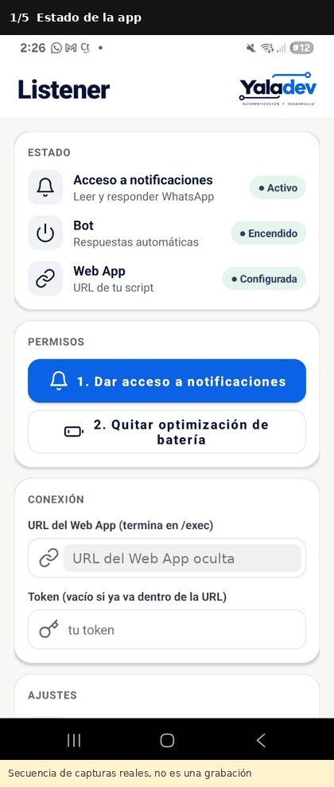
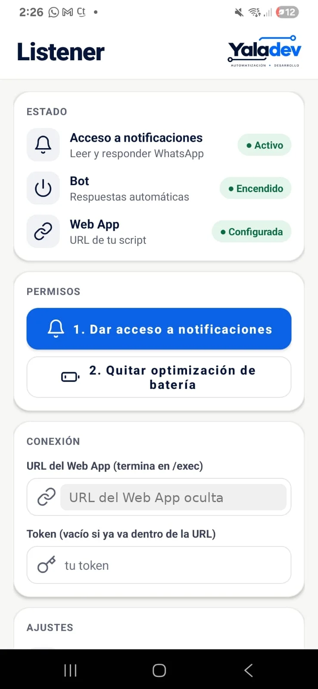
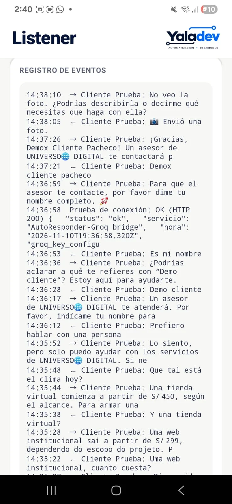
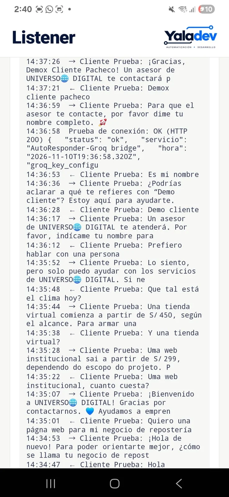
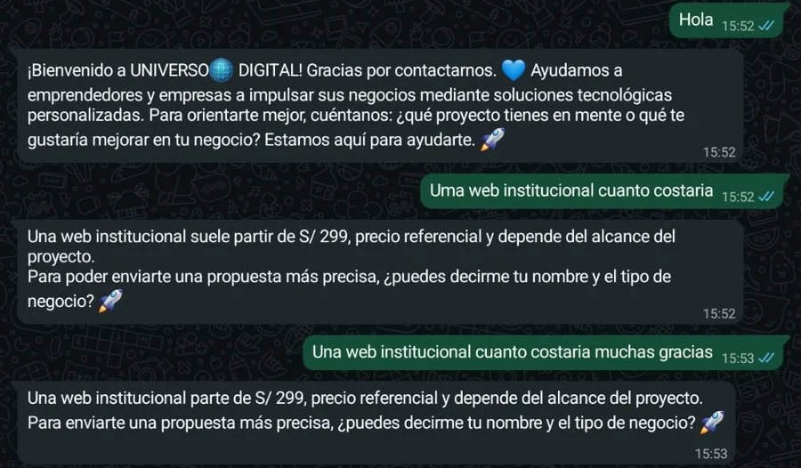

# Listener · Bot de WhatsApp con IA

Bot de auto-respuesta para WhatsApp y WhatsApp Business, construido como app Android propia.
Lee las notificaciones entrantes, consulta a un puente serverless en Google Apps Script y
responde automáticamente usando la acción "Responder" de la notificación.

> Estado: prototipo funcional, probado de punta a punta.

El código fuente es privado. Disponible para revisión bajo petición.

Yaladev es la marca del autor; UNIVERSO DIGITAL es el negocio de ejemplo usado en la prueba.



*Secuencia de capturas reales (no es una grabación de pantalla).*

## Qué es

Listener es un reemplazo propio de AutoResponder. En lugar de depender de una app de
terceros con funciones bloqueadas detrás de planes de pago, es una app Android minimalista
que:

- Escucha las notificaciones de `com.whatsapp` y `com.whatsapp.w4b`.
- Filtra grupos, duplicados y mensajes propios.
- Envía el mensaje a un puente serverless (Google Apps Script) que arma el contexto
  (prompt y memoria en Google Sheets) y llama a un modelo de lenguaje (Groq).
- Recibe la respuesta y la envía como reply de la notificación.

El prompt, el modelo y la memoria se editan desde una hoja de Google, sin recompilar la app.
El token de acceso vive en las propiedades del script, nunca en el código.

## Arquitectura

```
┌──────────────┐   notificación    ┌──────────────────┐   POST JSON    ┌──────────────────────┐
│  WhatsApp /  │ ────────────────► │  Listener (Kotlin) │ ─────────────► │  Google Apps Script  │
│  WhatsApp B. │                   │  BotListenerService│                │  (puente serverless) │
└──────────────┘                   └────────┬─────────┘                └──────────┬───────────┘
                                            │                                     │
                                            │ Responder (notificación)            │ Groq API
                                            ▼                                     ▼
                                   ┌──────────────────┐                ┌──────────────────────┐
                                   │  Cliente (chat)  │ ◄───────────── │  Google Sheets       │
                                   └──────────────────┘   reply        │  (prompt + memoria)  │
                                                                      └──────────────────────┘
```

## Funcionalidades

- Lectura de notificaciones de WhatsApp y WhatsApp Business.
- Filtro de grupos, duplicados y mensajes propios.
- Envío de `{"sender","message","isGroup","appPackageName"}` al puente.
- Acepta respuestas `{"reply":"..."}` y `{"replies":[{"message":"..."}]}`.
- Si el servidor devuelve vacío, HTML o un error, **no responde nada** al cliente.
- Pantalla de configuración: permisos, conexión, ajustes y registro de eventos.
- Estados con etiquetas de color: acceso a notificaciones, bot, Web App.
- Tema claro fijo.

## Decisiones técnicas

- **Prompt, modelo y memoria editables desde Google Sheets**, sin recompilar la app.
- **Token en las propiedades del script**, nunca en el código fuente.
- **Sin respuesta si el servidor falla**: evita enviar mensajes basura al cliente.
- **Registro de eventos en pantalla** para depurar cada mensaje recibido y enviado.
- **Técnica no oficial de WhatsApp**: depende de las notificaciones del sistema, por lo que
  requiere el celular encendido, con internet y con la notificación visible.

## Limitaciones conocidas

- Mismas limitaciones que AutoResponder: celular encendido y con internet, notificación visible,
  riesgo de bloqueo de WhatsApp.
- La detección de grupos depende de cómo WhatsApp arma la notificación: verifícala en pruebas.
- Notas de voz e imágenes llegan solo como texto genérico en la notificación.
- Cuota gratuita de Groq limitada.
- Dependencia del celular: no es un servidor 24/7 estable.

## Configuración en el celular

1. Abre la app y toca **1. Dar acceso a notificaciones**; activa "Listener".
2. Android 13 o superior: si la opción sale en gris, ve a Ajustes → Apps → Listener →
   menú ⋮ (arriba a la derecha) → **Permitir ajustes restringidos** y vuelve a intentarlo.
3. Toca **2. Quitar optimización de batería** y pon la app en "Sin restricciones".
4. Pega la URL del Web App y el token; toca **Guardar** y luego **Probar conexión**.
5. Desde otro teléfono, escribe al número del bot (con el celular del bot bloqueado y sin abrir ese chat).

## Resultados de la prueba

10 mensajes de prueba (9 de texto y 1 foto), los 10 respondidos. Tiempo de respuesta
entre 4 y 8 s, media de unos 6 s, medido en el registro de eventos. Una respuesta salió
en portugués ante un error de tipeo; se corrigió ajustando la regla de idioma del prompt
y se verificó en una re-prueba. Ante una imagen, la app pide una descripción en lugar de fallar.

## Siguientes pasos

- Usar la **API oficial de WhatsApp** (WhatsApp Business Platform) como ruta estable
  para uso comercial, eliminando la dependencia de notificaciones y el riesgo de bloqueo.

## Capturas



*Estado de la app: acceso a notificaciones, bot encendido y Web App configurada.*





*Registro de eventos de la primera sesión de pruebas: ← mensaje recibido, → respuesta enviada.*



*Re-prueba hecha después de corregir la regla de idioma del prompt.*
